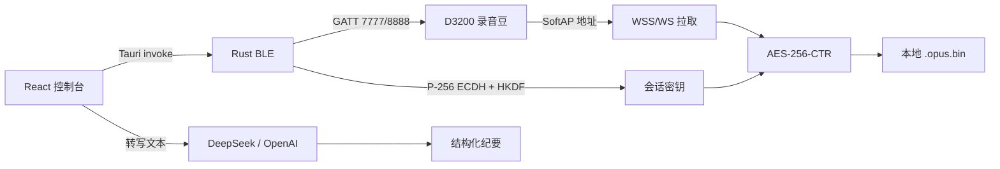

# UnboundBean · 无界豆

**让录音豆回到用户手里。**


UnboundBean（无界豆）是一个面向自有 **Soundcore Work / 安克 AI 录音豆 D3200** 的本地桌面管理工具。它通过 Tauri v2 的 Rust 后端完成 BLE 控制、P-256 密钥协商、Wi-Fi SoftAP 文件传输与 AES-256-CTR 解密，并以 React 控制台提供设备管理和 DeepSeek / OpenAI 兼容的文本总结能力。

> 本项目用于与用户本人拥有的硬件进行互操作。它不包含安克或飞书的固件、私钥、账号令牌或云端授权材料，也不以绕过第三方云服务访问控制为目标。

## 能做什么

- 按 D3200 服务 UUID 扫描并连接 BLE 设备，不依赖可能缺失的广播名称。
- 订阅 `7777` 写特征和 `8888` 通知特征，组装、校验并重组设备协议帧。
- 通过 P-256 ECDH 与 HKDF-SHA256 建立每次连接独立的 32 字节会话密钥。
- 读取设备录音索引，并请求设备启动 Wi-Fi SoftAP。
- 通过本地 WSS/WS 与 UDP keepalive 拉取 `1A07 / 1A08 / 1A0A` 文件流。
- 解包每个文件独立的 AES-256 密钥，并按序号对 160 字节音频单元进行 AES-256-CTR 解密。
- 将原始解密载荷导出为 `.opus.bin`，避免错误地把裸帧伪装成标准 Ogg/Opus。
- 将已有转写文本发送到 DeepSeek、OpenAI 或兼容端点，生成摘要、决策、待办和风险清单。
- API Key 仅驻留当前进程内存，不写入项目文件或本地配置。

## 工作流



详细设计：

- [系统架构与模块边界](docs/ARCHITECTURE.md)
- [D3200 协议实现说明](docs/PROTOCOL.md)
- [安全模型与隐私边界](docs/SECURITY.md)

## 为什么不是 AES-128-CBC

D3200 没有可硬编码进代码的固定 16 字节 Key/IV。当前公开逆向资料与本项目实现采用：

1. P-256 ECDH 交换临时公钥；
2. `HKDF-SHA256(shared, salt=01 02 03, info=01 02 03, len=32)` 派生会话密钥；
3. 用会话密钥和文件头中的 nonce 解包 `soundcored3200 || 32-byte fileKey`；
4. 使用文件密钥和 `nonce[0..12] || BE32(sequence * 10)` 解密每个 160 字节单元。

SoftAP 文件传输也不是 `/recordings/list.json` HTTP 下载，而是设备返回 IP/端口后建立本地 WebSocket 文件流。

## 技术栈

| 层 | 技术 |
|---|---|
| 桌面运行时 | Tauri v2 |
| 前端 | React 19、TypeScript、Vite、Tailwind CSS |
| BLE | Rust、btleplug、Tokio |
| 密码学 | p256、HKDF-SHA256、AES-256-CTR |
| SoftAP 传输 | tokio-tungstenite、native-tls、UDP keepalive |
| AI | reqwest、OpenAI Chat Completions 兼容接口 |
| 测试 | Vitest、Rust integration tests、Clippy、rustfmt |

## 环境要求（Windows）

1. Node.js 20 或更高版本。
2. Rust stable（通过 [rustup](https://rustup.rs/) 安装）。
3. Visual Studio 2022 Build Tools，安装“使用 C++ 的桌面开发”、MSVC 和 Windows 10/11 SDK。
4. Microsoft Edge WebView2 Runtime。
5. 可用的蓝牙适配器；录音豆不能同时被手机 App 占用。

## 本地运行

```powershell
git clone https://github.com/reyno2012-sudo/UnboundBean.git
cd UnboundBean
npm install
npm run tauri dev
```

项目提供了会自动载入 MSVC 环境的 Windows 辅助脚本：

```powershell
scripts\tauri-msvc.cmd dev
```

如果只想查看静态前端：

```powershell
npm run dev
```

然后打开 `http://127.0.0.1:1420`。浏览器模式无法调用 BLE、文件系统等 Tauri 命令。

## 测试与构建

```powershell
npm test
npm run build

cd src-tauri
cargo test
cargo clippy --all-targets -- -D warnings
cd ..

npm run tauri build
```

Windows 环境也可使用：

```powershell
scripts\cargo-msvc.cmd test
scripts\tauri-msvc.cmd build
```

编译产物位于 `src-tauri/target/release/`，安装包位于 `src-tauri/target/release/bundle/`。

## 使用步骤

1. 唤醒录音豆并确保手机 App 已断开。
2. 在无界豆中扫描并连接 D3200；应用会自动订阅通知并完成 ECDH 握手。
3. 刷新录音索引并选择一条已经完成的录音。
4. 启动 SoftAP，按界面显示的 SSID/密码在 Windows Wi-Fi 菜单中手动加入热点。
5. 返回无界豆，执行拉取与解密。
6. 将 Whisper、Soniox 或其他工具产生的转写文本粘贴到 AI 面板进行整理。

## 目录结构

```text
UnboundBean/
├── docs/                       # 架构、协议与安全说明
├── scripts/                    # Windows MSVC/Tauri 辅助脚本
├── src/                        # React 控制台
│   ├── App.tsx
│   ├── lib/tauri.ts            # 类型化 Tauri 命令桥
│   └── styles.css
└── src-tauri/
    ├── src/
    │   ├── ai.rs               # OpenAI 兼容总结接口
    │   ├── ble.rs              # 扫描、连接、GATT、ECDH、索引、SoftAP
    │   ├── crypto.rs           # HKDF 与 AES-256-CTR
    │   ├── protocol.rs         # 帧封装、校验和与通知重组
    │   ├── wifi.rs             # WSS/WS 文件流与 UDP keepalive
    │   └── lib.rs              # Tauri 状态和命令注册
    └── tests/                  # 协议与密码学向量测试
```

## 已知边界

- 当前需要用户手动加入设备 SoftAP；应用不会擅自修改系统 Wi-Fi 配置。
- 自签名 WSS 仅用于 BLE 返回的本地设备地址；当前没有证书固定能力，详见安全文档。
- 当前导出的是解密后的设备原始 Opus 载荷单元，不负责 Ogg 封装、播放或语音转写。
- 固件版本可能存在帧布局差异。实现会校验文件 ID、密钥 magic、分片序号、预期帧数和完成帧，校验失败不会输出伪成功文件。
- 尚未在此代码仓库的自动化环境中接入真实 D3200；真机兼容性仍需在不同固件上持续验证。

## 协议来源与致谢

协议实现主要依据：

- [tacshi/Soundcore](https://github.com/tacshi/Soundcore)
- [Soundcore PROTOCOL.md](https://github.com/tacshi/Soundcore/blob/main/PROTOCOL.md)

上游公开资料采用 MIT License。无界豆依据公开协议进行了独立 Rust 实现，未复制专有固件、云端凭据或私钥。

## 许可证

本仓库暂未附加开源许可证。在仓库所有者明确选择许可证之前，代码默认保留全部权利；上游项目及依赖各自遵循其原有许可证。
