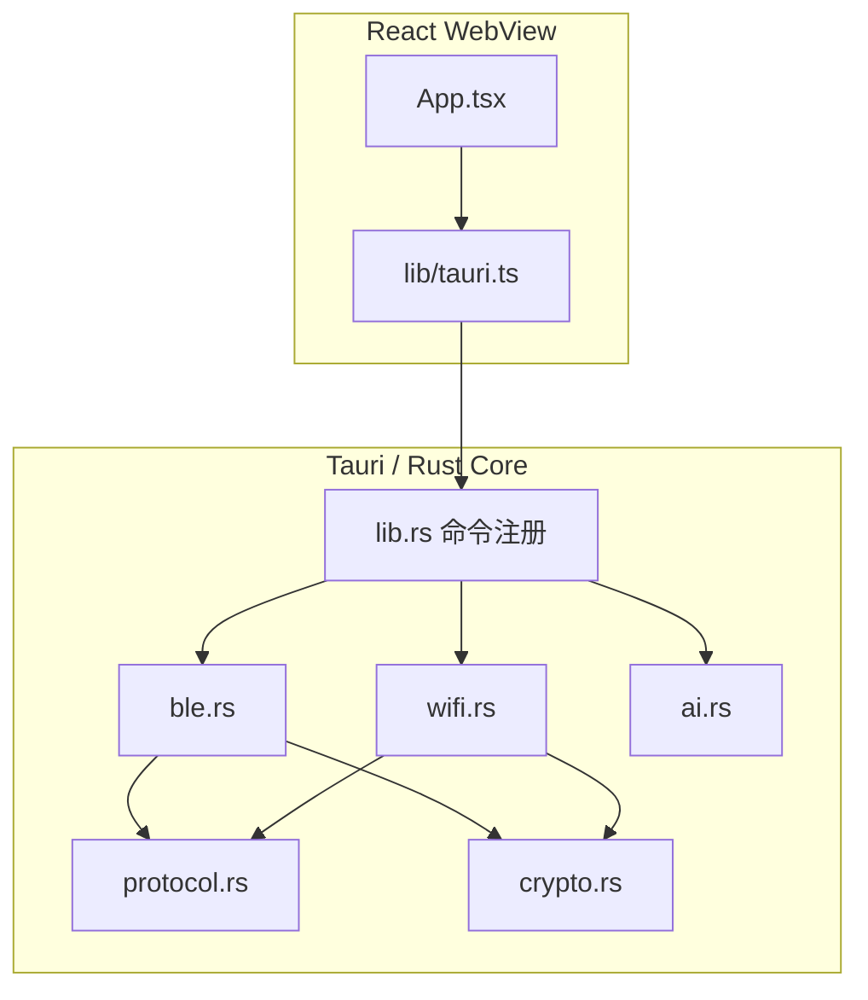

# 无界豆系统架构

## 目标

无界豆采用“本地优先、协议边界清晰、失败可验证”的设计。React 只处理交互状态，所有蓝牙、网络、密码学和磁盘操作都在 Rust 侧完成。

## 组件图

## 模块职责

| 模块 | 负责 | 不负责 |
|---|---|---|
| `App.tsx` | 页面状态、加载态、用户操作、错误展示 | BLE、密钥、文件 IO |
| `lib/tauri.ts` | 命令名称、请求/响应 TypeScript 类型 | 业务逻辑 |
| `lib.rs` | Tauri 状态注册、跨模块编排、默认导出目录 | 协议解析 |
| `ble.rs` | 扫描缓存、连接、特征发现、通知、ECDH、录音索引、SoftAP 请求 | WebSocket 文件流 |
| `protocol.rs` | TX 帧、校验和、RX 流式重组 | 设备状态 |
| `crypto.rs` | HKDF、文件密钥解包、音频单元解密 | 网络和磁盘 |
| `wifi.rs` | WSS/WS、UDP keepalive、分片顺序与完整性、落盘 | BLE 扫描 |
| `ai.rs` | 参数校验、OpenAI 兼容请求、响应解析 | API Key 持久化 |

## Tauri 命令边界

| 命令 | 输入 | 输出 |
|---|---|---|
| `scan_devices` | 无 | BLE 设备列表 |
| `connect_device` | `deviceId` | 安全连接状态 |
| `list_recordings` | 无 | 录音索引 |
| `prepare_wifi_export` | 无 | SSID、密码、IP、端口、WebSocket 地址 |
| `download_recording` | endpoint、host、fileId、输出目录 | 文件路径、分片数、字节数 |
| `summarize_transcript` | Key、base URL、模型、文本 | Markdown 纪要 |

## 状态与并发

`BleState` 是 Tauri 托管状态：

- `discovered` 保存最近一次扫描得到的 `Peripheral`，避免仅靠不稳定字符串重新发现设备。
- `connection` 保存当前 GATT 连接、写特征和会话密钥。
- 两者使用 Tokio `Mutex`，串行化对同一设备的命令，避免多个通知消费者抢占同一响应。
- 文件拉取阶段只复制 32 字节会话密钥，不依赖 SoftAP 期间可能已断开的 BLE 无线链路。

## 错误与完整性策略

- 每个 Tauri 命令返回 `Result<T, String>`，前端统一展示可读错误。
- BLE 请求有 10 秒超时；WebSocket 单次等待有 15 秒超时。
- RX 解码器支持通知任意位置拆包，并验证帧头、声明长度和加法校验和。
- 文件下载必须先收到与请求 ID 一致的加密文件头。
- 只有 magic、连续序号、预期分片数和 `1A/0A` 完成帧全部通过后才写文件。

## 为什么桌面端手动加入 SoftAP

自动操作 Windows Wi-Fi 需要额外系统权限、平台专用 API 和凭据处理。当前版本明确把“加入网络”留给用户，Rust 只连接设备通过 BLE 返回的本地 WebSocket 地址，从而降低权限范围和误连风险。
